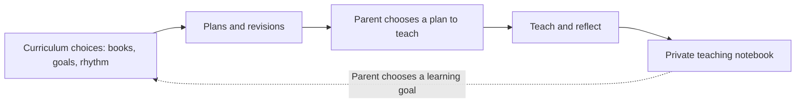
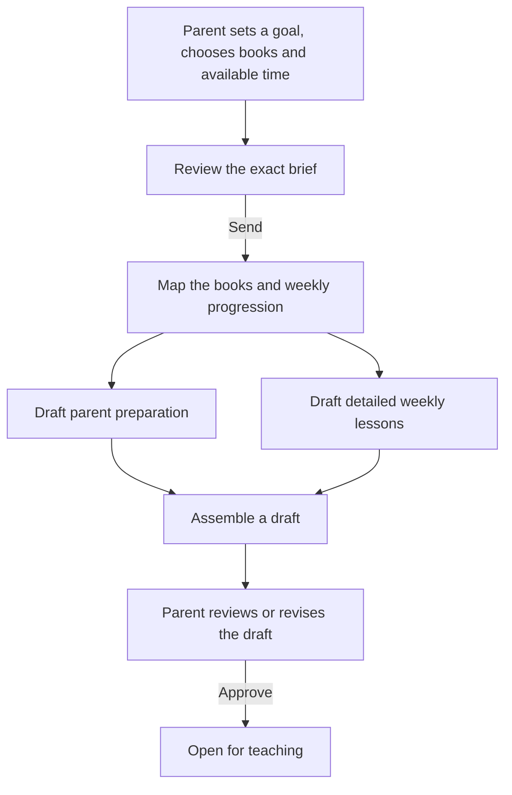
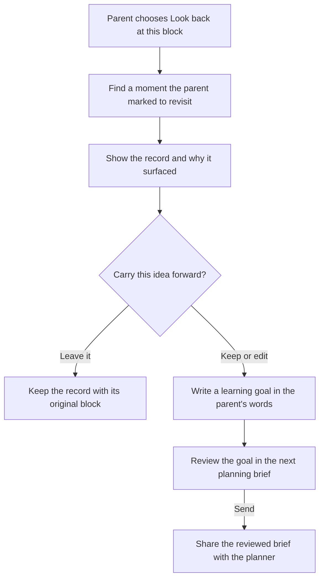

# Living Work design diagrams

[Back to the project overview](README.md)

## Moving parts of Living Work

In the local workspace design, one curriculum can guide several plans. The parent chooses a plan to teach, then decides which moments are worth remembering. The notebook is private teaching memory. A parent can express a new learning goal in their own words for a later plan.

## How a plan is assembled

The planner starts with a reviewed brief and a shared progression for the block. The preparation guide and detailed weeks build on that progression. The result opens as a draft the parent can change.

The planning request uses the reviewed educational brief and source guidance. Private notebook entries and learner work stay on the family’s device.

## Looking back and carrying a choice forward

This is a proposed design. A parent might revisit something they marked during a writing block, then decide whether to use the same practice when writing about an experiment. The original teaching record stays private. The parent can use, edit, or leave the idea.

An MCP connection could make that reviewed brief available to the planner. The parent would see the exact information before deciding to share it.
